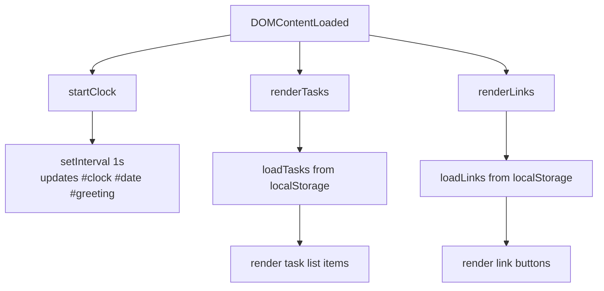
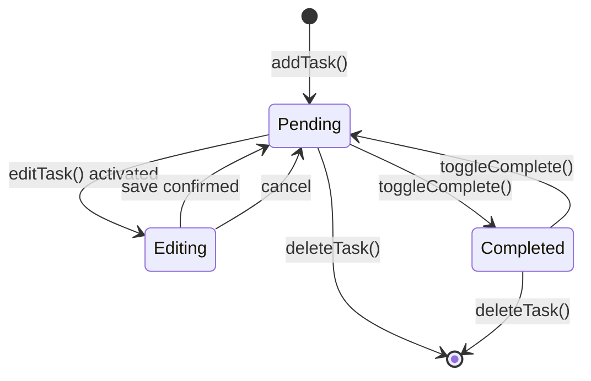

# Design Document — Sanusaurus To-Do App

## Overview

Sanusaurus is a single-page, browser-based productivity app built entirely with HTML5, CSS, and vanilla JavaScript. There are no build tools, no frameworks, and no server-side components — everything runs in the browser using the Local Storage API for persistence.

The app is composed of four independent feature panels rendered in a single `index.html` page:

| Panel | Purpose |
|---|---|
| Greeting Panel | Live clock, date, and time-based greeting |
| Focus Timer | 25-minute Pomodoro-style countdown |
| Task Manager | Full to-do list (add, edit, complete, delete) |
| Quick Links | User-defined bookmark buttons |

All state that must survive page reloads (tasks and links) is serialised to JSON and stored in `window.localStorage`.

---

## Architecture

The entire application lives in three files:

```
index.html        ← single entry point, all markup
css/style.css     ← all styles (dark-blue theme + colorful accents)
js/app.js         ← all logic, split into modules by feature panel
```

### Module boundaries inside `js/app.js`

Each feature is implemented as a self-contained logical section inside `app.js`, exposed through a plain-object namespace. There are no ES module `import`/`export` statements — all sections share the single global scope, so inter-section calls are simple function invocations.

```
app.js
├── Clock module         — getGreeting(), formatDate(), startClock()
├── Timer module         — startTimer(), stopTimer(), resetTimer(), handleTimerEnd()
├── TaskManager module   — loadTasks(), saveTasks(), addTask(), editTask(),
│                          toggleComplete(), deleteTask(), renderTasks()
└── QuickLinks module    — loadLinks(), saveLinks(), addLink(), deleteLink(),
                           renderLinks()
```

Startup sequence:

```
DOMContentLoaded
  ├── startClock()          — kicks off setInterval for clock
  ├── renderTasks()         — reads Task_Store and renders list
  └── renderLinks()         — reads Link_Store and renders buttons
```

---

## Components and Interfaces

### 2.1 Greeting Panel

**DOM elements**

| ID | Element | Content |
|---|---|---|
| `#clock` | `<span>` | Current time HH:MM:SS |
| `#date` | `<span>` | Human-readable date |
| `#greeting` | `<h2>` | "Good Morning / Afternoon / Evening / Night" |

**Key functions**

```javascript
// Returns greeting string based on hour (0–23)
getGreeting(hour: number): string

// Returns human-readable date string
formatDate(date: Date): string

// Starts a 1-second interval that updates #clock, #date, #greeting
startClock(): void
```

**Greeting logic**

| Hour range | Message |
|---|---|
| 05 – 11 | Good Morning |
| 12 – 17 | Good Afternoon |
| 18 – 20 | Good Evening |
| 21 – 04 | Good Night |

---

### 2.2 Focus Timer

**DOM elements**

| ID | Element | Content |
|---|---|---|
| `#timer-display` | `<span>` | Countdown MM:SS |
| `#btn-start` | `<button>` | Start |
| `#btn-stop` | `<button>` | Stop |
| `#btn-reset` | `<button>` | Reset |

**State variables** (module-level inside `app.js`)

```javascript
let timerSeconds = 25 * 60;   // remaining seconds
let timerInterval = null;      // setInterval handle (null = stopped)
```

**Key functions**

```javascript
startTimer(): void    // sets interval, disables Start button
stopTimer(): void     // clears interval, preserves timerSeconds
resetTimer(): void    // clears interval, resets timerSeconds to 1500, re-renders
handleTimerEnd(): void // called when timerSeconds reaches 0; plays notification
formatTime(seconds: number): string  // "MM:SS"
```

**State machine**

```
IDLE ──[Start]──► RUNNING ──[Stop]──► PAUSED ──[Start]──► RUNNING
         │                  │                │
         └──[Reset]──────────┴──[Reset]───────┴──► IDLE
RUNNING ──[reaches 00:00]──► ENDED ──[Reset]──► IDLE
```

---

### 2.3 Task Manager

**DOM elements**

| ID / Class | Element | Purpose |
|---|---|---|
| `#task-input` | `<input type="text">` | New task description |
| `#btn-add-task` | `<button>` | Submit new task |
| `#task-error` | `<span>` | Inline validation message |
| `#task-list` | `<ul>` | Rendered task items |
| `.task-item` | `<li>` | Per-task row |
| `.task-checkbox` | `<input type="checkbox">` | Complete toggle |
| `.task-text` | `<span>` | Display text |
| `.task-edit-input` | `<input type="text">` | Edit field (shown on edit) |
| `.btn-edit` | `<button>` | Activate edit mode |
| `.btn-save` | `<button>` | Confirm edit |
| `.btn-cancel` | `<button>` | Cancel edit |
| `.btn-delete` | `<button>` | Delete task |

**Key functions**

```javascript
loadTasks(): Task[]          // reads + parses Task_Store; returns [] on error
saveTasks(tasks: Task[]): void  // serialises array to Task_Store
addTask(description: string): void
editTask(id: string, newDescription: string): void
toggleComplete(id: string): void
deleteTask(id: string): void
renderTasks(): void          // full re-render of #task-list from in-memory array
```

---

### 2.4 Quick Links

**DOM elements**

| ID / Class | Element | Purpose |
|---|---|---|
| `#link-label-input` | `<input type="text">` | New link label |
| `#link-url-input` | `<input type="url">` | New link URL |
| `#btn-add-link` | `<button>` | Submit new link |
| `#link-error` | `<span>` | Inline validation message |
| `#links-container` | `<div>` | Rendered link buttons |
| `.link-btn` | `<a>` / `<button>` | Opens URL in new tab |
| `.btn-delete-link` | `<button>` | Delete individual link |

**Key functions**

```javascript
loadLinks(): Link[]          // reads + parses Link_Store; returns [] on error
saveLinks(links: Link[]): void
addLink(label: string, url: string): void
deleteLink(id: string): void
renderLinks(): void
isValidUrl(url: string): boolean  // must start with http:// or https://
```

---

## Data Models

### Task

```javascript
{
  id: string,          // crypto.randomUUID() or Date.now().toString()
  description: string, // non-empty, trimmed
  completed: boolean   // false on creation
}
```

**Storage key:** `sanusaurus_tasks`  
**Format:** `JSON.stringify(Task[])`

### Link

```javascript
{
  id: string,    // unique identifier
  label: string, // non-empty display text
  url: string    // must begin with "http://" or "https://"
}
```

**Storage key:** `sanusaurus_links`  
**Format:** `JSON.stringify(Link[])`

### Local Storage schema

```
localStorage
├── "sanusaurus_tasks"  →  '[{"id":"...","description":"...","completed":false},...]'
└── "sanusaurus_links"  →  '[{"id":"...","label":"...","url":"https://..."},...]'
```

---


## Correctness Properties

*A property is a characteristic or behavior that should hold true across all valid executions of a system — essentially, a formal statement about what the system should do. Properties serve as the bridge between human-readable specifications and machine-verifiable correctness guarantees.*

---

### Property 1: Time formatting always produces HH:MM:SS

*For any* valid `Date` object, the time-formatting function shall return a string that matches the pattern `HH:MM:SS` (two-digit hours, two-digit minutes, two-digit seconds separated by colons).

**Validates: Requirements 2.1**

---

### Property 2: Date formatting always includes weekday, day, month, and year

*For any* valid `Date` object, `formatDate()` shall return a string that contains a full weekday name, a numeric day, a full month name, and a four-digit year.

**Validates: Requirements 2.2**

---

### Property 3: Greeting correctly maps every hour to the right message

*For any* integer hour in the range 0–23, `getGreeting(hour)` shall return exactly one of the four strings — "Good Morning", "Good Afternoon", "Good Evening", or "Good Night" — and the returned string shall match the expected mapping:
- hours 5–11 → "Good Morning"
- hours 12–17 → "Good Afternoon"
- hours 18–20 → "Good Evening"
- hours 0–4 and 21–23 → "Good Night"

**Validates: Requirements 2.3, 2.4, 2.5, 2.6**

---

### Property 4: Adding a valid task grows the task list by exactly one

*For any* existing task list and any non-empty, non-whitespace task description, calling `addTask(description)` shall cause the task list length to increase by exactly one and the new task's description shall equal the trimmed input.

**Validates: Requirements 4.2**

---

### Property 5: Whitespace-only descriptions are always rejected by addTask

*For any* string composed entirely of whitespace characters (spaces, tabs, newlines), calling `addTask(description)` shall not increase the task list length and shall display a validation message.

**Validates: Requirements 4.5**

---

### Property 6: Adding a task persists it to Local Storage

*For any* valid task description, after calling `addTask(description)`, reading and deserialising the Task_Store from Local Storage shall produce an array that contains a task with the added description.

**Validates: Requirements 4.4**

---

### Property 7: Editing a task with a valid description updates its stored value

*For any* existing task and any non-empty, non-whitespace new description, calling `editTask(id, newDescription)` shall result in the task's description equalling the trimmed new description, and loading from Local Storage shall reflect the updated value.

**Validates: Requirements 5.3, 5.4**

---

### Property 8: Whitespace-only edits are always rejected

*For any* existing task and any whitespace-only new description, calling `editTask(id, newDescription)` shall leave the task's description unchanged.

**Validates: Requirements 5.5**

---

### Property 9: Toggling completion persists the new state to Local Storage

*For any* task, after calling `toggleComplete(id)`, loading the task list from Local Storage shall show the task's `completed` field flipped from its prior value.

**Validates: Requirements 6.3**

---

### Property 10: Double-toggling completion returns a task to its original state

*For any* task with any initial completion state, calling `toggleComplete(id)` twice shall return the task's `completed` field to its original value (idempotence round-trip).

**Validates: Requirements 6.4**

---

### Property 11: Deleting a task removes it from the list and from Local Storage

*For any* non-empty task list and any task in it, after calling `deleteTask(id)`, the task list length shall decrease by exactly one, the deleted task shall not appear in the in-memory list, and loading from Local Storage shall also not include the deleted task.

**Validates: Requirements 7.2, 7.3**

---

### Property 12: Task array serialisation round-trip preserves all data

*For any* array of valid `Task` objects, serialising to JSON then deserialising shall produce an array that is deeply equal to the original — preserving each task's `id`, `description`, and `completed` fields.

**Validates: Requirements 8.2, 8.5**

---

### Property 13: Adding a valid link grows the links list by exactly one

*For any* existing links list and any non-empty label with a URL that begins with `http://` or `https://`, calling `addLink(label, url)` shall cause the links list length to increase by exactly one, and the new link shall have the provided label and URL.

**Validates: Requirements 9.2**

---

### Property 14: Adding a link persists it to Local Storage

*For any* valid label and URL, after calling `addLink(label, url)`, reading and deserialising the Link_Store from Local Storage shall produce an array that contains a link with the added label and URL.

**Validates: Requirements 9.3**

---

### Property 15: Invalid link inputs are always rejected

*For any* input pair where the label is empty or whitespace-only, OR the URL does not begin with `http://` or `https://`, calling `addLink(label, url)` shall not increase the links list length and shall display a validation message.

**Validates: Requirements 9.7**

---

### Property 16: Deleting a link removes it from the list and from Local Storage

*For any* non-empty links list and any link in it, after calling `deleteLink(id)`, the link list length shall decrease by exactly one, the deleted link shall not appear in the in-memory list, and loading from Local Storage shall not include the deleted link.

**Validates: Requirements 9.6**

---

### Property 17: Link array serialisation round-trip preserves all data

*For any* array of valid `Link` objects, serialising to JSON then deserialising shall produce an array that is deeply equal to the original — preserving each link's `id`, `label`, and `url` fields.

**Validates: Requirements 10.2, 10.5**

---

## Error Handling

### Input Validation

All user inputs are validated before any state mutation occurs.

| Scenario | Handling |
|---|---|
| Empty / whitespace task description | Reject; show inline `#task-error` message; do not mutate list |
| Empty / whitespace edit description | Reject; retain original task description |
| Empty link label | Reject; show inline `#link-error` message |
| URL not starting with `http://` or `https://` | Reject; show inline `#link-error` message |

Validation messages are cleared when the user next interacts with the input.

### Local Storage Failures

Both `loadTasks()` and `loadLinks()` wrap JSON parsing in a `try/catch`. If the stored value is `null`, an empty string, or malformed JSON, the function returns an empty array and logs a warning to the console. The app never throws an uncaught error due to a corrupt store.

```javascript
function loadTasks() {
  try {
    return JSON.parse(localStorage.getItem('sanusaurus_tasks') || '[]') || [];
  } catch (e) {
    console.warn('sanusaurus_tasks: invalid JSON, resetting.', e);
    return [];
  }
}
```

### Timer Edge Cases

- Starting the timer when `timerSeconds === 0` is a no-op (guard at the top of `startTimer()`).
- Calling `stopTimer()` when the timer is not running is a no-op (guard: `if (!timerInterval) return`).
- `handleTimerEnd()` clears the interval before triggering the notification to prevent double-fires.

---

## Testing Strategy

### Overview

Two complementary layers of automated testing cover the application:

1. **Unit / example-based tests** — verify specific behaviours, state transitions, edge cases, and DOM interactions using concrete examples.
2. **Property-based tests** — verify universal correctness properties across a large randomised input space.

Both layers target the pure-function and data-manipulation logic inside `js/app.js`. Browser-specific side-effects (DOM rendering, `window.open`, `setInterval`) are tested with mocks/stubs or example-based integration tests.

### Test Framework

- **Test runner:** [Vitest](https://vitest.dev/) (lightweight, zero-config, browser-compatible output)
- **Property-based testing library:** [fast-check](https://fast-check.dev/)
- **DOM mocking:** jsdom (bundled with Vitest's `environment: 'jsdom'` setting)

Each property-based test MUST run a minimum of **100 iterations** (fast-check default).

### Unit / Example Tests

Cover the following scenarios:

| Area | Scenarios |
|---|---|
| Greeting Panel | Clock updates every 1000 ms (fake timers); date format on a known date |
| Focus Timer | Initial state is "25:00"; Start disables button; Stop preserves time; Reset returns to "25:00"; reaches 00:00 and stops; Start ignored when at 00:00 |
| Task Manager DOM | Input and Add button present; each task item has edit, delete, and checkbox controls; edit mode shows pre-filled input; cancel edit retains original text |
| Quick Links DOM | Label/URL inputs and Add Link button present; each link has a delete button; link button opens URL in new tab (`window.open` mock) |
| Local Storage loading | `loadTasks()` returns tasks when valid JSON is stored; `loadLinks()` returns links when valid JSON is stored; both return `[]` for null, empty, or malformed JSON |

### Property-Based Tests

Each property test references the corresponding design property by tag comment.

| Tag | Property |
|---|---|
| `Feature: sanusaurus-todo, Property 1` | Time formatting always produces HH:MM:SS |
| `Feature: sanusaurus-todo, Property 2` | Date formatting always includes weekday, day, month, year |
| `Feature: sanusaurus-todo, Property 3` | Greeting correctly maps every hour to the right message |
| `Feature: sanusaurus-todo, Property 4` | Adding a valid task grows the task list by exactly one |
| `Feature: sanusaurus-todo, Property 5` | Whitespace-only descriptions are always rejected by addTask |
| `Feature: sanusaurus-todo, Property 6` | Adding a task persists it to Local Storage |
| `Feature: sanusaurus-todo, Property 7` | Editing a task with a valid description updates its stored value |
| `Feature: sanusaurus-todo, Property 8` | Whitespace-only edits are always rejected |
| `Feature: sanusaurus-todo, Property 9` | Toggling completion persists the new state to Local Storage |
| `Feature: sanusaurus-todo, Property 10` | Double-toggling completion returns a task to its original state |
| `Feature: sanusaurus-todo, Property 11` | Deleting a task removes it from the list and from Local Storage |
| `Feature: sanusaurus-todo, Property 12` | Task array serialisation round-trip preserves all data |
| `Feature: sanusaurus-todo, Property 13` | Adding a valid link grows the links list by exactly one |
| `Feature: sanusaurus-todo, Property 14` | Adding a link persists it to Local Storage |
| `Feature: sanusaurus-todo, Property 15` | Invalid link inputs are always rejected |
| `Feature: sanusaurus-todo, Property 16` | Deleting a link removes it from the list and from Local Storage |
| `Feature: sanusaurus-todo, Property 17` | Link array serialisation round-trip preserves all data |

### Diagrams

#### Component rendering flow



#### Task lifecycle


